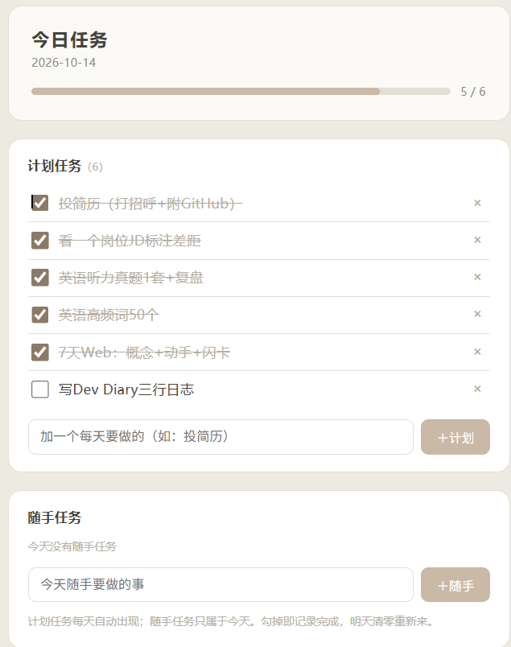

# 今日任务

每日待办 + 主动提醒：**计划任务**（每天自动出现）+ **随手任务**（只当天），勾选记录完成。

## 界面预览



## 安装
1. 装依赖：
   ```
   pip install -r requirements.txt
   ```
2. 启动：双击 `启动任务.bat`，或：
   ```
   python -m uvicorn main:app --host 127.0.0.1 --port 8901
   ```
   浏览器打开 http://127.0.0.1:8901

## 定时提醒（Windows）
双击 `安装任务提醒.bat`（每天 09:00 弹通知，列出未完成任务，点开自动起服务）。

## 数据
- 任务存 `tasks.json`（git 忽略，首次运行自动创建）
- 计划任务每天重现，随手任务只属于当天，勾掉即记录完成
